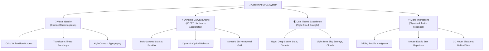

# 🌌 AcademAI (ScholarLens) — Next-Gen Academic UI/UX Interface

> **Nền tảng Khám phá Tài nguyên Học thuật Thông minh với Trải nghiệm Giao diện Vũ trụ (Cosmic Academic Luxury & Glassmorphism).**

[](https://github.com/Long9boy/Software-UI-UX-interface)
[](https://github.com/Long9boy/Software-UI-UX-interface)
[](https://github.com/Long9boy/Software-UI-UX-interface)
[](https://github.com/Long9boy/Software-UI-UX-interface)

---

## 🎨 1. Triết Lý Thiết Kế & Ngôn Ngữ Giao Diện (Design Philosophy)

AcademAI được định hình không chỉ là một công cụ tìm kiếm học thuật thông thường, mà là một **tác phẩm tương tác thị giác cao cấp**. Dự án kết hợp hài hòa giữa **Cosmic Deep Space (Vũ trụ sâu thẳm)** và **Academic Luxury Glassmorphism (Kính mờ học thuật sang trọng)**, mang đến cảm giác khám phá tri thức như đang du hành giữa các thiên hà.



---

## ✨ 2. Điểm Nhấn Thiết Kế Giao Diện & Tương Tác (Key UI/UX Highlights)

### 🌟 2.1. Bầu Trời Sao Đa Tầng & Hiệu Ứng Thị Sai (Cosmic Parallax)
- **Sao Kim Cương (Jewel Stars):** Được thiết kế với tia sáng chữ thập 4 cánh thon nhọn đối xứng chuẩn thiên văn học (*Diffraction Spikes*), tâm sáng rực rỡ và quầng hào quang mềm mại (Tím thạch anh `#c084fc`, Đỏ ruby `#f87171`, Xanh sapphire `#38bdf8`, Trắng kim cương `#ffffff`).
- **Sao Chữ Thập Xa (Distant Mini Cross Stars):** Kích thước siêu nhỏ thanh mảnh, trôi với vận tốc chậm hơn sao tiền cảnh, tạo chiều sâu không gian 3D hùng vĩ (*Cosmic Parallax*).
- **Nhịp Thở Tinh Tú (Sporadic Organic Twinkle):** Thay vì chớp nháy liên tục gây mỏi mắt, các vì sao duy trì sự tĩnh lặng êm đềm; ngẫu nhiên mỗi 20–45 giây sẽ có 2–4 ngôi sao bừng sáng nhẹ nhàng rồi dịu về trạng thái tĩnh, mô phỏng chân thực bầu trời đêm thiên văn.

### 🌌 2.2. Tinh Vân Phát Quang Động (Dynamic Blended Nebulae)
- Tích hợp 2 tác phẩm tinh vân thiên văn học chân thực (Cụm tinh vân hồng tím lấp lánh & Khối mây khí xanh lam huyền ảo).
- **Kỹ thuật hòa trộn ánh sáng (*Screen & Lighter Blending*):** Khử sạch 100% màu nền đen của ảnh, giữ lại lớp khí phát quang hòa quyện tự nhiên vào dải ngân hà sâu thẳm.
- **Bố cục ngẫu nhiên (*Procedural Celestial Composition*):** Mỗi lần tải trang hoặc chuyển sang giao diện ban đêm, hệ thống tự động sinh ngẫu nhiên góc xoay, tọa độ và tỉ lệ phân bổ giữa hai tinh vân, giúp người dùng luôn có trải nghiệm thị giác mới lạ.

### 🔷 2.3. Lưới Lục Giác 3D Tương Tác (3D Isometric Hex Grid)
- Nằm gọn gàng tinh tế ở góc dưới bên phải màn hình, mang biểu tượng của cấu trúc phân tử và mạng lưới tri thức.
- **Tương tác chuột 3D (*Proximity Levitation*):** Khi rê chuột qua, các khối lục giác tự động nổi khối 3D nâng cao lên, thành khối chuyển màu sâu và mặt trên biến đổi thành chất liệu kính trong suốt nhìn thấu các vì sao đang trôi lững lờ phía sau.

### ☄️ 2.4. Sao Chổi Băng Qua Bầu Trời (Celestial Comets)
- Thỉnh thoảng, một ngôi sao chổi bất ngờ bay vụt qua bầu trời đêm theo góc nghiêng tự nhiên với vệt đuôi gradient dài lộng lẫy và tan biến dần vào không gian.

---

## 🌓 3. Hệ Thống Đa Giao Diện (Dual Theme Architecture)

AcademAI hỗ trợ chuyển đổi linh hoạt giữa hai thế giới giao diện chỉ với 1 click:

| Đặc tính UI/UX | 🌌 Night Theme (Ban Đêm) | ☀️ Light Theme (Ban Ngày) |
|---|---|---|
| **Tone màu chủ đạo** | Deep Cosmic Black (`#010409`), Xanh Navy thẫm | Bầu trời xanh thanh khiết (`#58b4ff` $\rightarrow$ `#cdeaff`) |
| **Nền Canvas** | Tinh vân hòa trộn, sao đa tầng, sao chổi, lục giác neon | Mặt trời xoay chậm với tia nắng quang học, nhiều tầng mây trôi |
| **Khung Card & Viền** | Viền trắng tinh khôi (`1.5px solid #fff`) + Glow hào quang | Viền xanh đại dương thanh lịch + Đổ bóng mềm mại |
| **Chữ & Độ tương phản** | Chromatic Text Glow (Cyan & Trắng phát quang) | Chữ xanh đen đậm chuẩn tương phản WCAG AAA |
| **Cảm xúc mang lại** | Tập trung cao độ, huyền bí, sang trọng, dịu mắt ban đêm | Tràn đầy năng lượng, trong trẻo, tươi sáng cho ban ngày |

---

## 💫 4. Trải Nghiệm Tương Tác & Vi Tương Tác (Micro-Interactions)

- **Bong bóng điều hướng lướt êm (*Gliding Bubble Tab Navigation*):** Nút chọn tab có viên nang ánh sáng nổi lướt mềm mại từ tab hiện tại sang tab mới mà không bị giật hay nhảy về đầu thanh.
- **Lực đẩy đàn hồi (*Mouse Elastic Star Repulsion*):** Khi con trỏ chuột di chuyển trên màn hình, các vì sao xung quanh nhẹ nhàng tản ra như mặt nước gợn sóng và từ từ quay về quỹ đạo trôi ban đầu.
- **Dropdown Slide-Down Animation:** Các menu thả xuống và bộ lọc kết quả mở ra với chuyển động trượt êm ái kết hợp làm mờ hậu cảnh (*Backdrop Blur*).
- **Hộp tìm kiếm Floating Capsule:** Thanh tìm kiếm nổi trung tâm với viền phát sáng khi focus, tích hợp phím tắt nhanh và chip phân loại câu hỏi thông minh (*Semantic Entity Chips*).

---

## 🚀 5. Tối Ưu Hóa Hiệu Năng Đỉnh Cao (Engine Performance)

Dù sở hữu đồ họa chuyển động thời gian thực phức tạp, AcademAI vẫn đạt hiệu năng vận hành vượt trội:

- ⚡ **Pre-rendered Sprites:** Toàn bộ quầng sao, tia chữ thập và cụm mây được vẽ sẵn vào các canvas đệm nhỏ, loại bỏ việc khởi tạo Gradient và Path phức tạp trong vòng lặp chính.
- 📐 **Pre-computed Geometry:** Hình học 6 đỉnh lục giác và các gradient trạng thái nghỉ được tính toán trước bằng `Float32Array`, không sinh rác bộ nhớ (*Zero Garbage Collection Thrashing*).
- ⏱️ **60 FPS Throttling:** Cố định nhịp dựng 16.6ms, chống tình trạng quá tải hoặc hao pin trên màn hình tần số quét cao (120Hz/144Hz/240Hz).
- 🛑 **Page Visibility API Freeze:** Tự động đóng băng hoàn toàn vòng lặp render khi người dùng chuyển tab $\rightarrow$ **Giảm tải CPU về 0% tuyệt đối** khi chạy nền.
- 📉 **CPU tiêu thụ thông thường:** Chỉ từ **1% – 2%** trên các trình duyệt hiện đại.

---

## 🛠️ 6. Khởi Chạy Ứng Dụng (Quick Start)

Dự án được xây dựng với kiến trúc Zero-Dependency (không cần `npm install`, chạy thuần với Node.js 18+):

```bash
# 1. Khởi động máy chủ
node server.js

# 2. Truy cập ứng dụng tại trình duyệt
http://localhost:3000
```

### 🔑 Tài khoản Demo trải nghiệm
| Vai trò | Email | Mật khẩu | Đặc quyền |
|---|---|---|---|
| **Quản trị viên** | `admin@academai.vn` | `admin123` | Quản lý API Key, Cấu hình hệ thống |
| **Sinh viên** | `sinhvien@academai.vn` | `user123` | Tìm kiếm, lưu bộ sưu tập, xuất trích dẫn |

---

## 📂 7. Cấu Trúc Dự Án (Repository Structure)

```text
AcademAI/
├── assets/             # Hình ảnh tinh vân vũ trụ (nebula-1.png, nebula-2.jpg)
├── css/
│   ├── style.css       # Hệ thống Style chính, Glassmorphism, Neon glow & Layout
│   ├── theme.css       # Bộ biến và phong cách giao diện Dual Theme (Night / Light)
│   └── settings.css    # Giao diện Cài đặt, Quản trị và Tùy chỉnh người dùng
├── js/
│   ├── background.js   # Cosmic Background Engine v6 (Stars, Nebulae, Clouds, Hexagons)
│   ├── theme.js        # Trình điều khiển chuyển đổi giao diện Night / Light
│   ├── app.js          # Logic tương tác trang chủ, tìm kiếm, tab và bong bóng trượt
│   ├── settings.js     # Modal cài đặt, bộ sưu tập cá nhân, quản trị API key
│   ├── parser.js       # Phân tích thực thể ngôn ngữ tự nhiên
│   └── featured.js     # Danh sách bài báo học thuật tiêu biểu
├── server/             # Backend xử lý tìm kiếm đa nguồn (OpenAlex, Crossref, Google Books)
├── server.js           # HTTP Server phục vụ static files & API
└── README.md           # Tài liệu dự án
```

---

<div align="center">
  <sub>Thiết kế và phát triển với niềm đam mê dành cho Giao diện Người dùng Hiện đại & Trải nghiệm Học thuật Tương lai.</sub>
</div>
